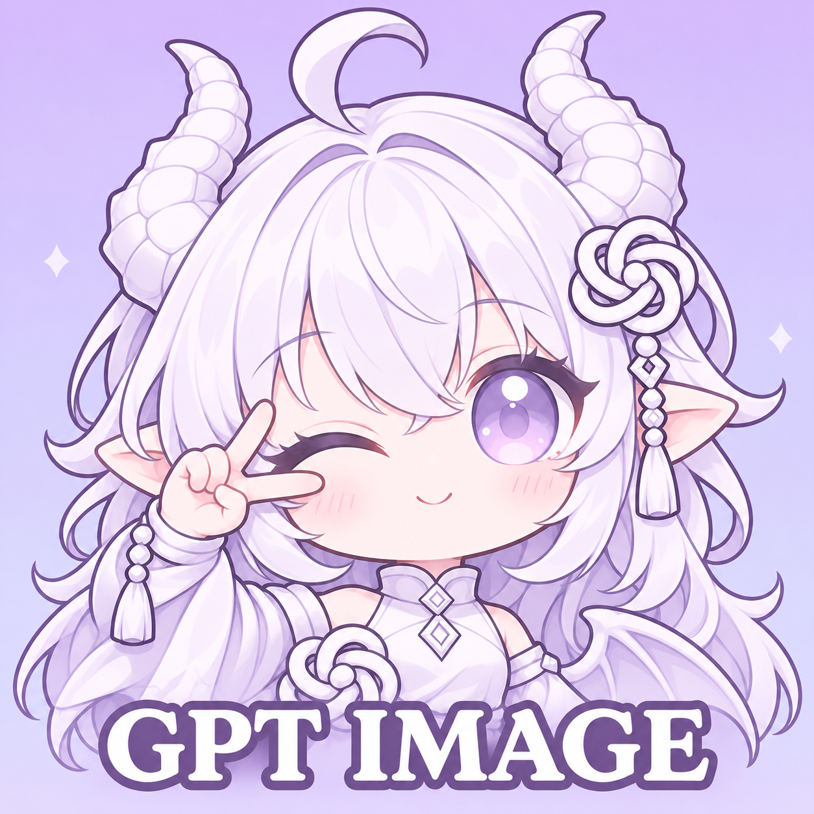

# GPT Image · 龙绘

<p align="center">
  
</p>

面向 AstrBot 的 GPT Image / OpenAI-compatible **生图与改图插件**。复用 AstrBot 已配置的模型，提供自然对话画图、参考图编辑、确认式高级画图，以及可调帧数和速度的原生 GIF。

不想记命令？可以直接说「帮我画一只戴围巾的小猫」。触发条件和完整过程见 [自然对话如何触发生图](#自然对话如何触发生图)。

当前版本 **1.4.1**，原显示名为 **Image2 Studio**。仓库地址保持不变，内部插件标识和函数工具名也保持不变，方便已有用户升级。

## 功能一览

| 功能 | 说明 |
| --- | --- |
| 模型下拉选择 | 普通画图与高级画图分别选择 AstrBot 已配置的模型，自动复用接口地址、密钥和自定义请求头 |
| 自然对话画图 | 对话模型识别图片需求后调用工具，后台生成完成后发送结果 |
| 自拍与人设 | 由当前对话 LLM 根据当前人设组织无参考图提示词，不内置固定自拍人物设定 |
| 文生图与改图 | 支持文字生成、单图修改和多图参考；只读取本条消息或明确回复/引用的图片 |
| 原样画图 | `/绘图` 将用户提示词原样直通，不做提示词增强或英文化 |
| 高级画图 /plan | 先多轮整理需求、预览最终提示词，再确认生成；预览与提交共用已准备的提示词 |
| 原生 GIF | 开关独立，帧数、速度、尺寸均可下拉选择；需上游实际开放原生动画能力 |
| 流程追踪 | 通过流程 ID 查看路由、实际提交提示词、接口阶段与发送结果，带请求者和会话访问限制 |
| 简易配置 | 常用图片参数使用中文下拉，高级项默认折叠，提供保守默认值 |
| 运行控制 | 支持并发限制、图片缓存、下载重试及可选静态图提交重试 |

## 安装

要求 AstrBot **4.29.4 或更新版本**。插件使用 AstrBot 原生配置界面，不需要修改前端或安装额外管理页面。

在 AstrBot 插件管理中选择从 Git 仓库安装，填入：

```text
https://github.com/aaron6769/astrbot-plugin-Image2-Studio
```

运行依赖在 [requirements.txt](requirements.txt) 中声明：`aiohttp` 与 `Pillow`。若安装过程中提示缺少依赖，请在 **AstrBot 实际使用的 Python 环境**中安装该文件列出的依赖，再重载插件。

这是基于原插件维护的分支，市场标识为 `aaron6769/astrbot_plugin_gpt_image_2`；包名 `astrbot_plugin_gpt_image_2` 和画图工具名称保持不变。**不要与原版或旧版重复安装**；已有用户应更新原插件目录，并先备份配置。更换安装目录可能导致 AstrBot 使用另一份配置文件。维护者命名空间不替代原代码作者署名。

本仓库公开不代表已经上架 AstrBot 插件市场，目前可通过上述仓库地址安装。

## 三步开始画图

1. 在 AstrBot 的模型管理中，配置一个实际支持 OpenAI-compatible **Images 接口**的生图模型。
2. 打开本插件配置，在「普通画图模型」下拉中选中该条目。无需再次填写 API Key 或 Base URL。
3. 其余保持默认值，保存配置并按 AstrBot 提示重载插件，发送：

```text
/生图 一只坐在窗边晒太阳的橘猫
```

群聊中需要明确 **@机器人本体**；@全体或@其他人不算。私聊可以直接发送。

普通聊天模型即使出现在 AstrBot 的下拉列表中，也不一定能生图。必须选择上游确实支持 Images 接口的条目，插件会使用该条目中的真实模型名。

### 普通模型、高级模型和整理模型有什么区别？

- **普通画图模型**：用于自然对话、自拍、`/生图`、`/绘图` 和 `/改图`。
- **高级画图模型**：用于 `/plan confirm` 后的生成或修改，可以与普通模型相同；不用高级画图时可留空。
- **需求整理模型**：只负责 /plan 阶段整理文字需求，默认跟随当前对话模型；有参考图时需要视觉能力。

两种画图模型可以来自不同供应商，各自复用所选条目的连接信息。所选条目缺失、被停用或被删除时会明确报错，**不会自动切换到其他供应商**。

## 自然对话如何触发生图

**默认由当前聊天 LLM 判断用户是否要求现在出图，再调用画图工具；不是看到「图片」「自拍」等关键词就自动生成。** 不用输入 `/生图`，也不用配置专门的触发词。

### 使用前提

- AstrBot 的当前对话模型支持函数工具调用，并允许使用 `generate_image_with_gpt_image_2`。
- 本插件已选好可用的「普通画图模型」。聊天模型负责理解需求，普通画图模型负责出图，两者职责不同。
- 消息先满足 AstrBot 自身的对话唤醒、权限和会话配置。私聊可直接提出要求；群聊还必须通过平台实际 **@机器人本体**，只打机器人名字、@全体或@其他成员都不算。
- 自然对话请求 GIF 时，还需打开本插件的 GIF 开关，并使用实际支持原生动画的上游。

### 从聊天到出图的过程

1. **理解意图**：插件在对话请求中附加画图工具使用说明；当前 LLM 结合本轮消息、对话上下文和实际生效的人设，判断是出图、改图，还是仅讨论图片。
2. **组织提示词与参数**：明确要求出图时，LLM 写出完整视觉提示词，并按需求选择比例、尺寸、质量等参数。要求当前 bot 的自拍时，由 LLM 把人设中的外观、服装、表情等展开写入提示词；指定其他人物时，工具规则要求保留该人物，不得替换成 bot。
3. **调用并校验工具**：LLM 调用 `generate_image_with_gpt_image_2`。插件再次检查群聊是否 @本机器人、参考图是否存在、GIF 是否启用及参数是否有效；不满足条件时拒绝执行。自然对话使用「普通画图模型」，不会自动进入 `/plan` 或切换高级模型。
4. **提交任务**：默认立即返回带流程 ID 的任务受理状态，聊天模型按当前人设回复一句确认。无参考图时直接使用 LLM 的提示词，仅追加显式风格参数，不再次套固定自拍人设、增强、翻译或前后缀模板。
5. **发送结果**：插件在后台生成，完成后将图片或动图发回当前会话；失败会报告错误。收到「开始画了」不代表已经生成成功，可用 `/生图流程 流程ID` 查询。

工具说明要求**同一条用户消息最多调用一次**；插件也会复用该消息仍在执行中的任务，防止重复调用造成重复提交。

### 哪些话会触发，哪些不会？

下表是默认提供给 LLM 的判断规则，并非保证每个模型都能准确执行的关键词分类器。表达不明确时，应先询问，不主动出图。

| 用户表达 | 预期处理 |
| --- | --- |
| 「帮我画一只戴围巾的小猫，水彩风格」 | 调用工具生成静态图 |
| 「按你当前的人设，发一张你在咖啡馆的自拍」 | 当前 LLM 根据本轮人设组织提示词，再调用工具 |
| 附图或明确回复目标图：「保留人物，把背景换成雪山」 | 设置 `use_reference_images=true`，调用改图 |
| 「做一张蓝色小球弹跳的 GIF，4 帧，每帧 120 毫秒」 | 设置 GIF 格式、帧数和时长；仍受 GIF 开关与上游能力限制 |
| 「帮我写一段画猫的提示词」「翻译这个提示词」 | 只处理文字，不调用画图 |
| 「分析这张图的风格」「海报用什么配色好？」 | 分析或给建议，不调用画图 |
| 「你能画图吗？」「GIF 可以设置多少帧？」 | 回答能力或参数问题，不直接出图 |
| 「把刚才那张改一下」，但未附图或明确回复目标图 | 请用户附图或引用目标图，不自动取历史图片 |

参考图只有在 LLM 明确设置 `use_reference_images=true` 时才会收集，范围仅限本条消息和明确回复/引用的消息。设置为 `false` 就保持纯文生图，不会因为提示词里出现「改图」等字样自动带图。有参考图时，可按配置启用参考图提示词增强。

意图判断主要依赖 LLM 的工具遵循能力，插件不会再用另一个语义分类器审核每句话；群聊 @、参考图来源、GIF 开关与参数则有代码层面的检查。因此聊天模型只说「我来画」而没有实际调用工具，并不算任务已受理。

### 和「关键词直接触发画图」有什么区别？

在「显示高级设置 → 性能与缓存」中，还有独立的「关键词直接触发画图」（`runtime.enable_direct_keyword_trigger`），**默认关闭**。关闭它不影响上面的自然对话工具调用。

开启后，部分明确的普通生图或带图修改请求，可由插件的固定规则直接接管，无需先让聊天模型选择工具。这不是自然对话功能的总开关，也不是完整的语义理解；自拍/人设类纯文字请求、GIF 请求仍交给当前 LLM。通常保持关闭即可。

只停用自然对话工具调用，可在 AstrBot 工具管理中关闭 `generate_image_with_gpt_image_2`。若希望只保留显式命令，还要确保「关键词直接触发画图」关闭；`/生图`、`/改图`、`/绘图`、`/plan` 是独立命令入口。

## 常用命令

| 命令 | 用途 |
| --- | --- |
| `/生图 描述` | 普通文生图 |
| `/改图 修改要求` | 修改本条消息或明确引用的图片 |
| `/绘图 描述` | 原样提示词直通，不增强、不翻译 |
| `/plan 需求` | 创建或补充高级画图计划 |
| `/plan status` | 查看当前计划与准备好的提示词 |
| `/plan confirm` | 确认后调用高级画图模型 |
| `/plan quit` | 退出当前计划 |
| `/生图流程 流程ID` | 查看对应图片任务的过程与结果 |
| `/查生图 流程ID` | 流程查询别名 |
| `/生图帮助` | 查看插件内帮助 |

### 静态图片

```text
/生图 雨夜街头的猫咪，电影感 --ratio 16:9 --quality high
/生图 简洁的竖版旅行海报 --size 1024x1536
/生图 一只可爱的白色小龙，贴纸风格 --transparent
/绘图 A small white dragon reading beside a window --size 1024x1024
```

尺寸、质量、比例、背景和输出格式也可以直接在后台下拉选择。固定像素尺寸优先于比例与清晰度档位；较大尺寸是否可用取决于所选模型和上游接口。

### 参考图编辑

先发送图片，或者明确回复/引用目标图片：

```text
/改图 保留人物和姿势，把背景换成雪山
```

支持多图参考，默认最多 16 张。插件不会自动沿用最近一张历史图片；需要修改上一张图时，请明确回复/引用它。

### 人设自拍

自然对话中可以说：

```text
按你当前的人设，给我发一张在咖啡馆的自拍。
```

这类请求由当前聊天 LLM 结合人设生成提示词，再调用插件。插件不会额外注入固定人物，也不会对无参考图的 LLM 工具提示词再次套用插件模板。

此功能依赖当前聊天模型支持函数工具；前置条件、触发判断和停用方式见 [自然对话如何触发生图](#自然对话如何触发生图)。

### 高级画图

```text
/plan 设计一张冬季咖啡活动海报，竖版，先整理需求不要直接生成
/plan 配色改为奶白和深棕，留出标题区域
/plan status
/plan confirm
```

整理稿与最终提交使用同一份准备好的提示词。重复确认有保护；准备失败、计划过期或参考图失效时会停止并提示，不会悄悄提交另一份提示词。

## GIF 动图

### 为什么标注仅限支持 GIF 的官方 API 源？

插件使用的是**接口直接返回的原生动画**，不是把静态图片改后缀，也不是在本地拼接多张静态图。

需要上游实际开放所选模型的 GIF 能力：可以直接连接支持的官方 API 源，也可以通过完整透传的中转。网页逆向、2api 等渠道未必开放原生动画；**模型名字相同不代表功能相同**。中转必须完整传递：

- `output_format=gif`
- `frame_count`
- `frame_duration_ms`

如果中转过滤、忽略或改写这些参数，可能生成失败，或帧数、速度与设置不符。插件不会仅凭域名或模型名宣称支持 GIF；它会检查返回内容是否为有效动画，并核对帧数和帧时长。

### 使用方法

先在「GIF 动图」分组打开功能开关，再选择默认帧数、播放速度和尺寸：

```text
/生图 蓝色小球上下弹跳，无缝循环 --format gif --frames 4 --frame-ms 120
```

| 参数 | 说明 | 默认 |
| --- | --- | --- |
| `--format gif` | 本次请求生成 GIF，仍需后台开关已启用 | 静态图默认为 PNG |
| `--frames` | 2–16 帧 | 9 帧 |
| `--frame-ms` | 每帧 20–2000 毫秒，按 10 毫秒取整；越小越快 | 200 毫秒 |
| `--size` | 每帧像素尺寸，需上游支持 | 自动 |

默认 9 帧 × 200 毫秒，每轮约 1.8 秒。动图尺寸与静态图片尺寸独立，不会继承静态图的 4K 设置。

使用边界：

- GIF 功能默认关闭，确认上游支持后再开启。开启开关不会把默认 PNG 自动改成 GIF。
- 当前只支持**文字生成 GIF**，不支持参考图、图生图，也不接受 GIF 请求中的 `--ratio` 或 `--resolution`。
- 帧数、尺寸与总像素预算还受上游限制；固定尺寸不被接受时，可选择自动尺寸或减少帧数。
- GIF 不自动重提，避免超时后重复扣费；失败不会静默降级成静态图。
- 关闭开关会拦截尚未提交的 GIF 请求；已提交到上游的任务不能撤回。
- QQ 动图发送已在实际部署环境验证；其他平台和客户端是否播放动画，仍取决于其媒体支持。

## 默认配置与高级设置

首次安装只需要选定普通画图模型。私人供应商无法预置为通用默认值，因此模型选择需要用户完成一次。

| 配置 | 默认 |
| --- | --- |
| 尺寸、比例、清晰度、质量、背景 | 自动 |
| 静态图片格式 | PNG |
| GIF 功能 | 关闭 |
| GIF 帧数 / 速度 / 尺寸 | 9 帧 / 200 毫秒每帧 / 自动 |
| 参考图提示词增强、英文化 | 关闭 |
| 关键词直接触发画图 | 关闭；自然对话仍由当前 LLM 调用工具 |
| 高级设置 | 折叠 |
| /plan 整理模型 | 跟随当前对话模型 |
| 图片生成超时 | 5 分钟 |
| 同时生成任务数 | 1 |
| 静态图网络故障重提 | 0 次 |
| 图片下载重试 | 1 次 |
| 图片缓存 | 3 天，最多 200 张 |

「显示高级设置」仅控制界面展开，不会禁用已有功能或重置已有配置。高级项包括 /plan 整理、参考图提示词增强、翻译、并发、重试和缓存；自定义提示词模板保留文本输入，留空使用内置模板。

提示词增强或翻译会增加模型调用。超时或连接中断不代表上游没有生成，手动重试或启用静态图提交重试可能重复扣费。即便静态图网络重提为 0，明确的参数兼容错误仍可能触发原有参数格式切换；GIF 不使用该兼容重试。

## 流程查询与隐私

每次任务都有流程 ID，可用 `/生图流程` 或 `/查生图` 查询。普通用户必须是原请求者，并处于同一平台和原会话；管理员跨会话排查仅允许在私聊中进行。

流程记录可能包含用户需求、最终提示词、接口阶段和结果信息。它们属于运行数据，不属于可公开的源码；报错反馈时请先脱敏，不要公开整个数据目录或完整请求头。

## 从旧版升级

1. 先备份插件目录、配置和必要的运行数据。
2. 在原插件目录更新，不要把新旧版本同时安装。
3. 重新打开配置，普通与高级画图都改为选择 AstrBot 模型条目；原先插件内手填 API 地址、Key、模型名的方式不再是新版配置入口。
4. 检查 GIF 开关。旧版帧数和帧时长会首次迁移到独立 GIF 分组；已有自定义设置不应被新安装的推荐默认值覆盖。

旧版固定自拍人设、最近图片自动沿用等行为已移除。历史文档仅反映当时状态，当前功能以本 README、schema 和代码为准。版本变化见 [CHANGELOG.md](CHANGELOG.md)。

## 测试与维护

本版本基于已在 AstrBot 4.29.4 / Python 3.12 环境通过 148 项自动化检查的 1.4.1 部署。公开包保留相同配置 schema 和图标，登记当前维护者，并从运行代码中移除一条私人内网地址的兼容特判；通用自动判断与静态图参数兼容回退保留。结果不代表所有模型、供应商和聊天平台均兼容。

仓库 CI 提供可复现的轻量检查：Python 语法、配置 JSON、版本一致性、配置与文档契约、图标结构。它不调用收费生图接口，也不读取私人供应商配置。

```bash
python -m py_compile main.py __init__.py
python -m json.tool _conf_schema.json
python -m unittest discover -s tests -v
```

开发与安全同步规则见 [DEVELOPMENT_SYNC.md](DEVELOPMENT_SYNC.md)。

## 常见问题

**下拉列表为空？**

先在 AstrBot 配置并启用模型条目，然后重新打开插件配置。

**能聊天，但生图失败？**

聊天接口可用不等于 Images 接口可用。检查实际模型名、供应商能力和接口地址；普通/高级模型分别检查。

**机器人没有自动调用画图？**

按顺序检查：消息是否唤醒当前 AstrBot 对话 → 聊天模型是否支持并启用函数工具 → `generate_image_with_gpt_image_2` 是否可用 → 群聊是否实际 @机器人本体 → 用户是否明确要求现在出图。

不要为了启用自然对话去打开「关键词直接触发画图」，它们是两条不同路径。若 `/生图 一只小猫` 能成功，但同样的自然对话请求只有文字回复，优先检查聊天模型的工具调用和自定义人设/工具说明是否冲突；不能只凭「我来画」认定已经提交。完整规则见 [自然对话如何触发生图](#自然对话如何触发生图)。

**GIF 返回静态图或帧设置不符？**

确认上游开放原生动画，并检查中转是否完整透传三个 GIF 参数。插件会报告不符情况，不把静态图当成成功动图。

**想修改刚才生成的图片？**

回复/引用那张图片，再输入 `/改图 修改要求`。插件不会猜测应该使用哪张历史图。

## 来源与许可

本项目基于 [starmiaoa/astrbot-plugin-gpt-image](https://github.com/starmiaoa/astrbot-plugin-gpt-image) 维护，保留原作者署名和 [MIT 许可证](LICENSE)。本仓库维护者为 [aaron6769](https://github.com/aaron6769)。

图标为 GPT 白龙娘的 AI 辅助同人二创，原角色设计署名 **ZipZipPipe**，按原作者说明仅作署名的非商业使用；不是 OpenAI、ChatGPT 或原神的官方角色或官方插件。图标、角色原设和第三方标识的使用说明见 [ARTWORK_NOTICE.md](ARTWORK_NOTICE.md)，代码许可证不自动覆盖这些素材。
